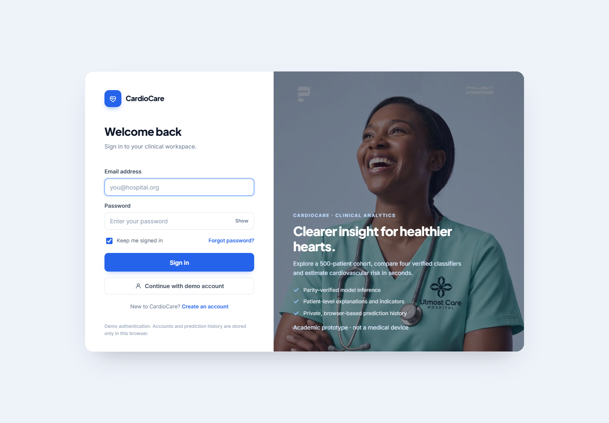
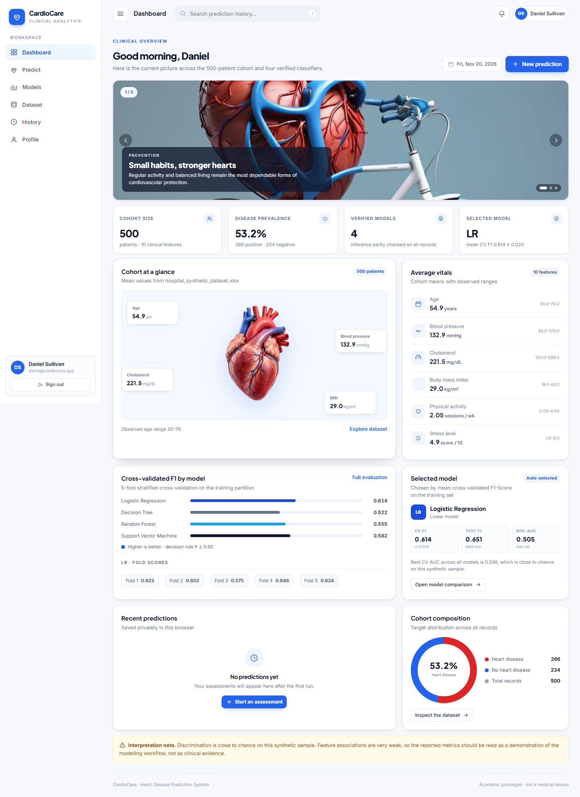
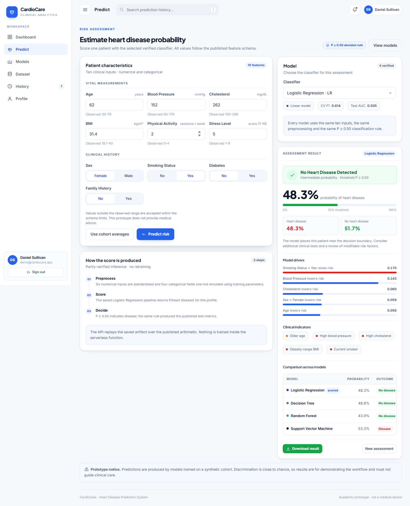
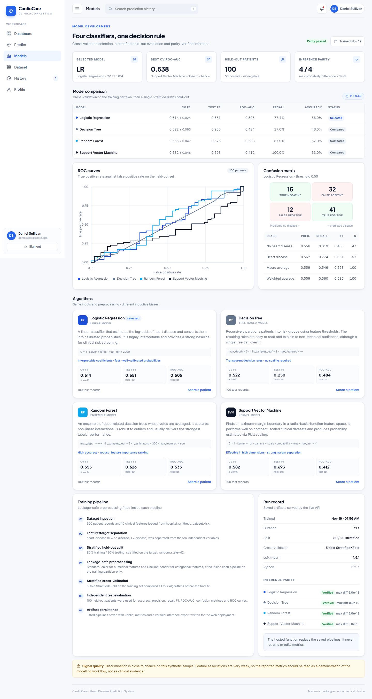
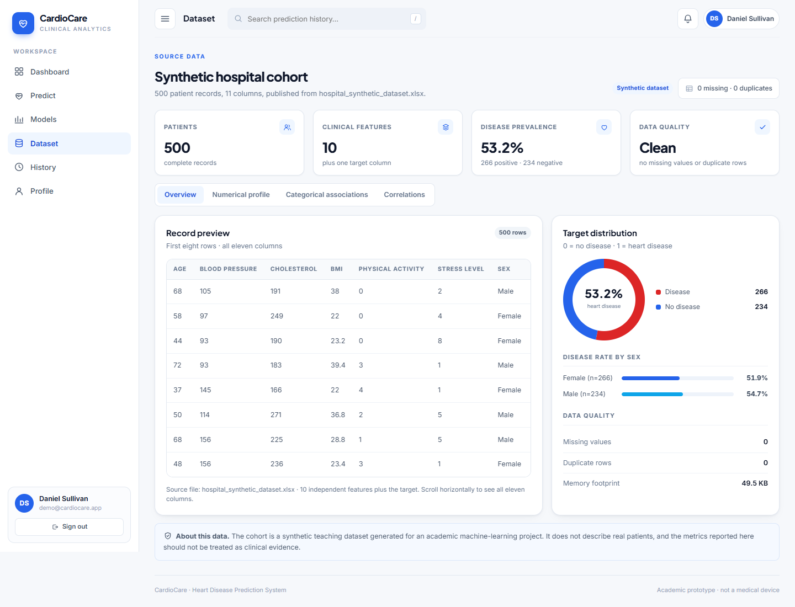
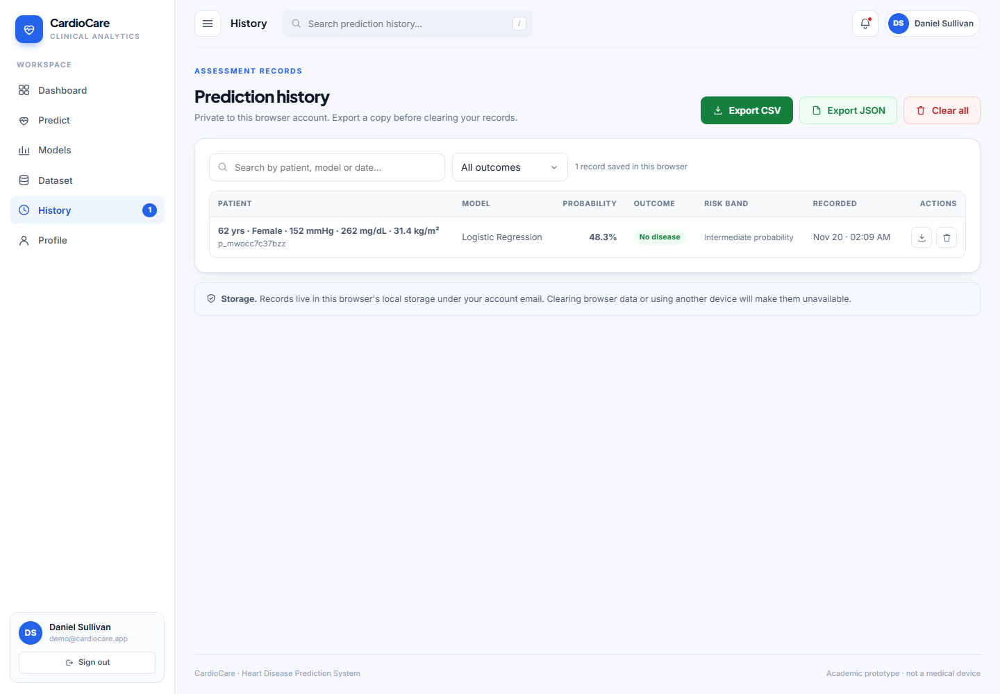
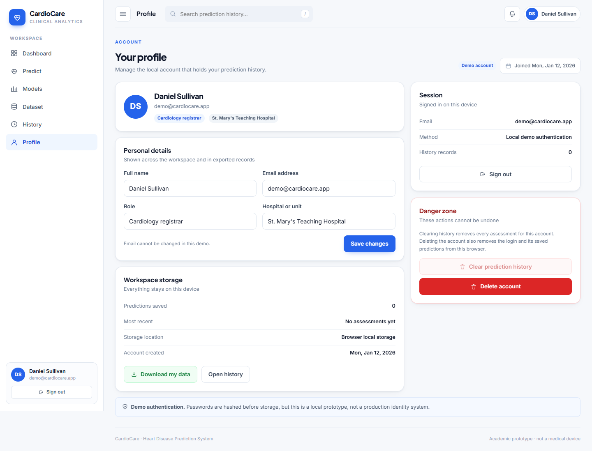
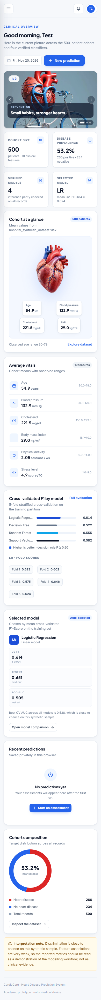

# Heart Disease Prediction System

A complete, reproducible machine-learning system that estimates a patient's
probability of heart disease from ten clinical inputs, compares four classifiers,
and exposes the full workflow through a healthcare analytics interface.

The project ships **two front ends that share one set of verified model artifacts**:

| Edition | Tech | Where it runs |
| --- | --- | --- |
| **Streamlit app** (academic edition) | Python · Streamlit · scikit-learn · Joblib | Local / any Python host |
| **Vercel web edition** | Static HTML/CSS/JS + a Node.js serverless function | Vercel (no Python at runtime) |

Both editions share the same verified artifacts and the same six-section
workspace — **Dashboard, Predict, Models, Dataset, History and Profile** — and
produce identical predictions. The web edition adds a local account layer with a
per-user prediction history.

> **This is an academic prototype, not a medical device.** It is trained on a
> 500-record *synthetic* dataset whose feature–target signal is close to chance.
> Do not use it for diagnosis, triage or treatment decisions.

---

## Live demo

- Web app: <https://heart-disease-prediction-ten-chi.vercel.app>
- Prediction API: `POST /api/predict`

### Screenshots

| Sign in / create account | Dashboard |
| --- | --- |
|  |  |

| Prediction result | Models |
| --- | --- |
|  |  |

| Dataset | History |
| --- | --- |
|  |  |

| Profile | Mobile dashboard |
| --- | --- |
|  |  |

---

## Web workspace

The web edition opens on a sign-in screen. Accounts are **client-side only**:
credentials and prediction history are kept in the browser's `localStorage`.
Passwords are stored as SHA-256 digests (with a deterministic fallback when
`crypto.subtle` is unavailable), and nothing is sent to a server.

- **Sign in** with an existing local account.
- **Create account** with a name, email and password (8+ characters).
- **Explore the demo** with the seeded account `demo@cardiocare.app` /
  `demo1234`.

Every prediction is saved per user under `cc_history_v2:<email>` (capped at 60
records). The History section supports search and risk filtering, per-row
**CSV/JSON download**, whole-history **CSV/JSON export**, single-row deletion and
clear-all. The Profile section lets a signed-in user update their name, role and
hospital, download their account data, clear history, sign out or delete the
account. Export and download actions are green; destructive actions are red.

The signed-in shell contains exactly six navigation items:

| Section | Contents |
| --- | --- |
| **Dashboard** | Image slideshow, cohort KPIs, heart overview, average vitals, cross-validated F1 by model, selected model, recent predictions, target distribution |
| **Predict** | Ten-field patient form, model picker, serverless scoring, probability meter, drivers, clinical indicators, cross-model comparison, result download |
| **Models** | Model KPIs, comparison table, ROC curves, confusion matrix, classification report, algorithm cards, training timeline and run record |
| **Dataset** | Record preview, target distribution, disease rate by sex, numeric summaries, IQR bars, correlation heatmap, data-quality notes |
| **History** | Per-user records with search, risk filter, count badge, CSV/JSON export, row download and deletion |
| **Profile** | Editable clinician details, account statistics, data download, sign out, clear history and account deletion |

---

## The dataset

`hospital_synthetic_dataset.xlsx` — the real synthetic hospital export supplied
with the project. Nothing is generated or substituted.

| Property | Value |
| --- | --- |
| Records | 500 |
| Columns | 11 (10 features + 1 target) |
| Missing cells | 0 |
| Duplicate rows | 0 |
| Target | `heart_disease` — 266 positive (53.2%), 234 negative (46.8%) |

**Features**

| Numerical | Categorical |
| --- | --- |
| `age`, `blood_pressure`, `cholesterol`, `bmi`, `physical_activity`, `stress_level` | `sex`, `smoker`, `diabetes`, `family_history` |

---

## Models

Four scikit-learn pipelines are trained under one identical protocol:

1. 80 / 20 **stratified** train–test split (`random_state=42`).
2. `StandardScaler` (numerical) + `OneHotEncoder` (categorical) inside a
   `Pipeline`, fitted on training folds only — **no leakage**.
3. 5-fold `StratifiedKFold` cross-validation on the training partition.
4. One final evaluation on the untouched 100-patient test set.
5. Fitted pipelines persisted with **Joblib**.

| Algorithm | Key hyperparameters |
| --- | --- |
| Logistic Regression | `C=1`, `solver=liblinear`, `max_iter=2000` |
| Decision Tree | `max_depth=5`, `min_samples_leaf=8` |
| Random Forest | `n_estimators=300`, `max_depth=8`, `min_samples_leaf=2` |
| Support Vector Machine | `kernel=rbf`, `C=1`, `gamma=scale`, `probability=True` (Platt) |

### Honest, measured results

Held-out test set (n = 100). Decision rule: **P(heart disease) ≥ 0.50** for every
model and every metric.

| Model | Accuracy | Precision | Recall | F1 | ROC-AUC | CV F1 |
| --- | --- | --- | --- | --- | --- | --- |
| Logistic Regression | 0.560 | 0.562 | 0.774 | **0.651** | 0.505 | 0.614 |
| Decision Tree | 0.460 | 0.474 | 0.170 | 0.250 | 0.484 | 0.522 |
| Random Forest | 0.570 | 0.581 | 0.679 | 0.626 | 0.533 | 0.555 |
| Support Vector Machine | 0.530 | 0.530 | 1.000 | 0.693 | 0.412 | 0.582 |

Models are selected by **mean cross-validated F1** on the training set, which
chooses **Logistic Regression** (CV F1 = 0.614). The highest cross-validated
ROC-AUC across all models is **0.538**.

**Interpretation.** Discrimination is close to chance on this synthetic sample.
These numbers are reported unchanged, precisely so the project demonstrates a
sound *workflow* rather than a clinically meaningful model. All values are stored
in `artifacts/metadata.json` and rendered from that file — none are hard-coded
into the UI.

---

## Repository layout

```
Heart-disease-prediction/
├── app.py                    # Streamlit entry point
├── train_models.py           # Reproducible training CLI
├── heart_ml/                 # Data, preprocessing, modelling, inference, export
│   ├── config.py             # Schema, bounds, model specs, paths, palette
│   ├── data.py               # Excel loading + dataset profiling
│   ├── preprocessing.py      # ColumnTransformer / pipeline construction
│   ├── modeling.py           # Training, cross-validation, evaluation
│   ├── inference.py          # Pure-Python replay of saved pipelines
│   ├── persistence.py        # Joblib save / load
│   ├── validation.py         # Input bounds + clinical flags
│   ├── export.py             # Portable JSON inference bundle
│   ├── publish.py            # Static JSON for the web edition
│   └── parity.py             # Python ⇄ scikit-learn parity checks
├── views/                    # Six Streamlit pages + shared design system
├── artifacts/                # Joblib pipelines, metadata, verification
├── public/                   # Vercel static front end + published data
│   ├── index.html            # Auth screen + six-section app shell
│   ├── assets/
│   │   ├── styles.css        # Blue/white design system
│   │   ├── app.js            # Auth, routing, charts, history, export
│   │   └── images/           # Login visual, slideshow slides, heart graphic
│   └── data/{dataset,models,training}.json
├── screenshots/              # Refreshed UI captures
├── api/
│   ├── predict.js            # Serverless prediction endpoint
│   ├── _engine.js            # Dependency-free arithmetic replay + validation
│   └── model_data.json       # Exported inference bundle (~2 MB)
├── scripts/
│   ├── verify_js.cjs         # JS ⇄ scikit-learn parity verifier
│   └── dev_server.cjs        # Local preview of the Vercel site
├── hospital_synthetic_dataset.xlsx
├── requirements.txt
├── package.json
└── vercel.json
```

---

## Run the Streamlit app (local)

```bash
python -m venv .venv
# Windows
.venv\Scripts\activate
# macOS / Linux
source .venv/bin/activate

pip install -r requirements.txt

# Reproduce training and regenerate every artifact (≈10 s)
python -W ignore::FutureWarning train_models.py

# Launch the app
streamlit run app.py
```

`train_models.py` writes:

- `artifacts/models/*.joblib` — fitted pipelines
- `artifacts/metadata.json` — metrics, environment, feature schema
- `artifacts/verification.json` — Python replay parity
- `artifacts/edge_models.json` + `artifacts/parity_reference.json`
- `public/data/*.json` and `api/model_data.json` — web edition inputs

---

## Run the Vercel web edition (local)

The static site can be previewed with the bundled zero-dependency server, which
also mounts the real serverless handler:

```bash
node scripts/dev_server.cjs
# → http://localhost:4173
```

Or use the Vercel CLI, which reproduces production routing exactly:

```bash
npx vercel dev
```

### Verify numerical parity

```bash
node scripts/verify_js.cjs
```

This replays all four exported pipelines in JavaScript and compares them with the
scikit-learn reference over **all 500 patient records**:

```
PASS  logistic_regression    max |dp| = 4.989e-13
PASS  decision_tree          max |dp| = 0.000e+0
PASS  random_forest          max |dp| = 5.033e-13
PASS  svm                    max |dp| = 4.995e-13
PASS  validation accepted a real dataset row
Overall: PASS
```

---

## Why a separate Vercel edition?

Streamlit needs a long-running WebSocket server; Vercel Functions are short-lived
and serverless. scikit-learn + SciPy + Pandas also exceed Vercel's 250 MB
function limit. The web edition therefore:

1. Exports each fitted pipeline to a compact arithmetic JSON representation once,
   offline, and
2. Replays the exact same arithmetic in a dependency-free Node.js function
   (standardisation, one-hot encoding, float32 tree traversal, libsvm Platt
   calibration).

The replay is continuously checked against scikit-learn, so the live API and the
notebooks produce the same probabilities to ~1e-13.

---

## API

`POST /api/predict`

```json
{
  "model": "logistic_regression",
  "patient": {
    "age": 68,
    "blood_pressure": 152,
    "cholesterol": 275,
    "bmi": 33.5,
    "physical_activity": 0,
    "stress_level": 8,
    "sex": "Male",
    "smoker": "Yes",
    "diabetes": "Yes",
    "family_history": "Yes"
  }
}
```

Response (abridged):

```json
{
  "ok": true,
  "model": "logistic_regression",
  "model_name": "Logistic Regression",
  "prediction": 1,
  "label": "Heart Disease Detected",
  "probability": 0.5024,
  "probability_no_disease": 0.4976,
  "threshold": 0.5,
  "risk_band": { "key": "moderate", "label": "Intermediate probability" },
  "drivers": [ ... ],
  "clinical_indicators": [ ... ],
  "comparison": { "...": "all four models scored on the same inputs" },
  "warnings": []
}
```

- `GET /api/predict` → service metadata and the model catalogue.
- Invalid input → `422` with a per-field `errors` array.
- Unknown model → `400`.

Input bounds are enforced server-side, and values outside the observed training
range come back as `warnings` (an extrapolation notice) without failing.

---

## Deploy to Vercel

```bash
npx vercel --prod
```

`vercel.json` serves `public/` as the static output and `api/predict.js` as a
Node function. `.vercelignore` excludes the Python training code and raw data, so
Vercel never tries to build a heavy Python function.

---

## Methodology notes

- **Leakage-safe:** scaler and encoder are fitted inside the pipeline, per fold.
- **Selection:** cross-validation on training data only; the test set is never
  used to choose a model.
- **Reproducible:** every split, fold and estimator uses `random_state=42`; the
  environment is recorded in the metadata.
- **Consistent decision rule:** the same 0.50 threshold drives metrics and live
  predictions, including for SVM (Platt probabilities, not the raw margin).
- **Fail-loud validation:** numeric ranges, categorical options and missing
  fields are checked in both Python and JavaScript with the same bounds.

---

## Limitations

- Synthetic 500-row cohort with near-zero learnable signal.
- No external validation, calibration study or fairness audit.
- Not reviewed as a medical device; no privacy or regulatory clearance.
- A real deployment would require a representative clinical cohort, prospective
  validation, calibration analysis, subgroup auditing and regulatory review.

---

## License and attribution

Academic machine-learning project. Dataset supplied for coursework; models are
provided for demonstration and research only.
